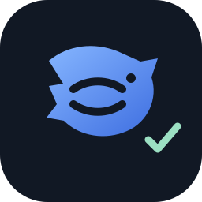
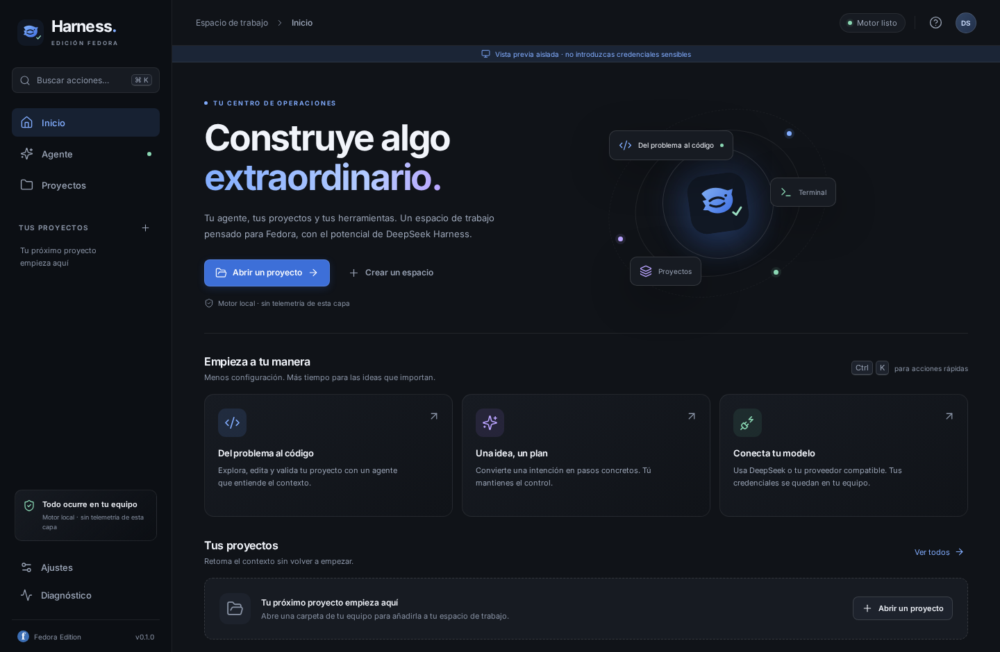
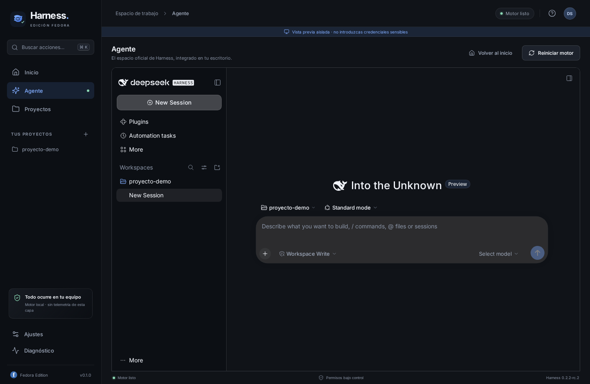
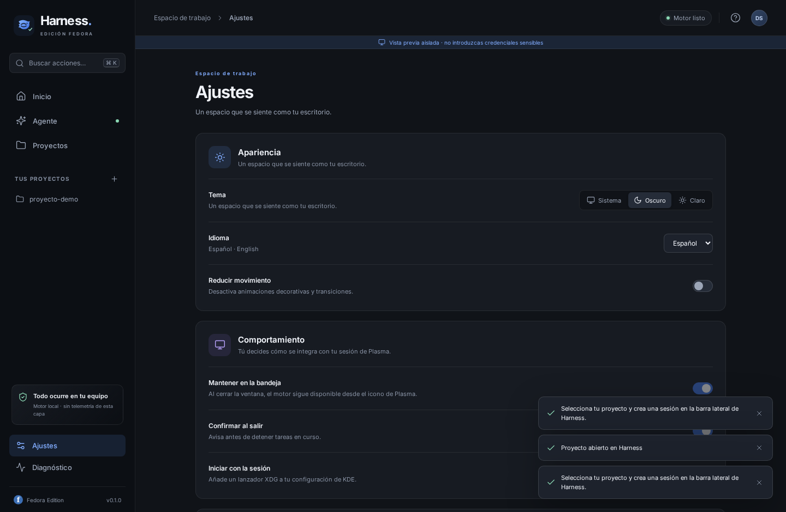
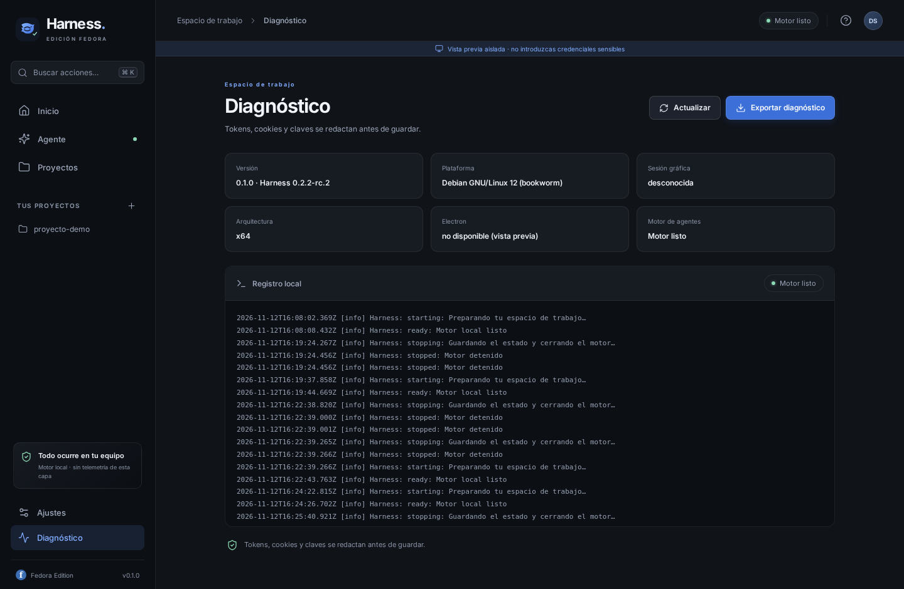
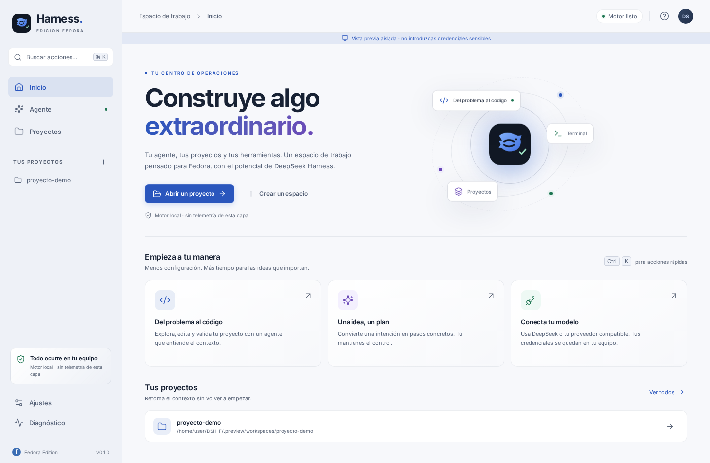
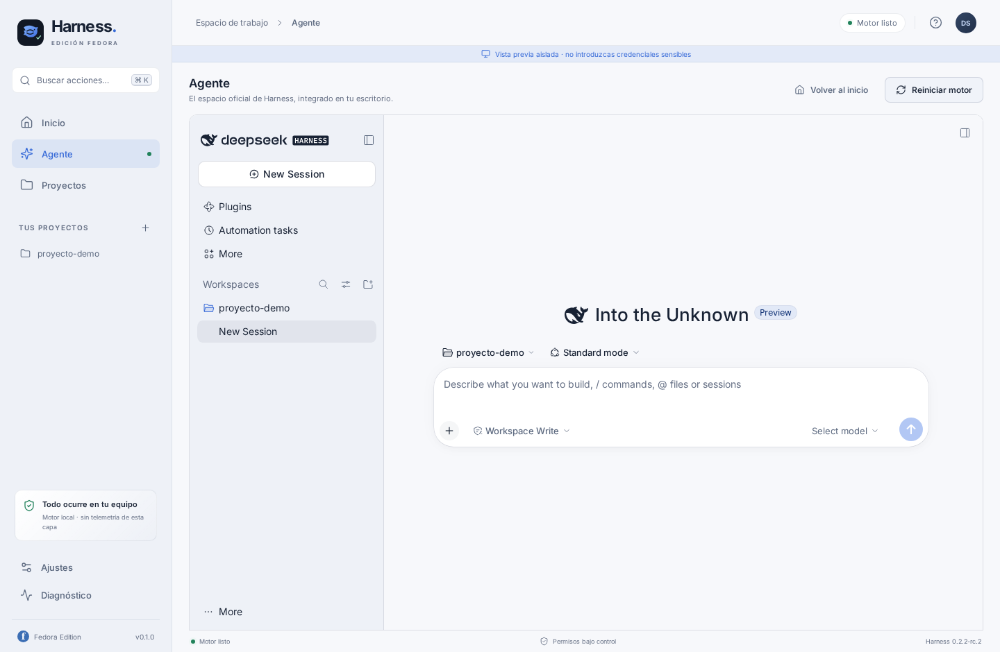

# DeepSeek Harness · Fedora Edition

<p align="center">
  
</p>

<p align="center">
  <strong>Tu agente, tus proyectos y tus herramientas. Un espacio de trabajo premium para Fedora KDE Plasma.</strong>
</p>

<p align="center">
  Edición comunitaria de escritorio construida sobre el motor oficial de
  <a href="https://github.com/deepseek-ai/deepseek-harness">DeepSeek Harness</a>
  <!-- upstream:version --><code>0.2.2-rc.2</code><!-- /upstream:version -->. No afiliada ni respaldada por DeepSeek.
</p>

---

## Qué es

DSH_F transforma DeepSeek Harness en una aplicación de escritorio nativa para **Fedora Linux + KDE Plasma**. Conserva el motor de agentes oficial (plugins, sesiones, workspaces, credenciales locales) y añade una capa de escritorio robusta:

- **Shell premium en español** con portada, proyectos recientes, paleta de comandos (`Ctrl+K`), ajustes y diagnóstico.
- **Motor oficial aislado**: proceso hijo con su propio Node incluido, `DSH_HOME` propio y permisos iniciales `workspace-write`.
- **Puente loopback autenticado**: el token de Harness nunca llega a la interfaz; cookie propia, tickets de un solo uso y proxy HTTP/WebSocket.
- **Integración Plasma**: bandeja, cerrar a bandeja, confirmación de salida, autostart XDG, tema claro/oscuro/sistema y notificaciones.
- **Tema unificado**: el agente oficial recibe la misma paleta y tipografía Inter que la shell, sin parchear el paquete upstream.
- **Empaquetado RPM** con dependencias Fedora y CI que instala el RPM en `fedora:latest`.
- **Privacidad por diseño**: sin telemetría de esta capa; logs redactados y rotados; preferencias atómicas `0600`.

> El núcleo de agentes no se reescribe ni se parchea: se ejecuta el paquete oficial fijado y cualificado por tests de integración.

## Capturas

| Inicio | Agente |
|---|---|
|  |  |

| Ajustes | Diagnóstico |
|---|---|
|  |  |

El agente oficial hereda la misma paleta que la shell en ambos temas:

| Inicio claro | Agente claro |
|---|---|
|  |  |

## Instalación en Fedora

```bash
sudo dnf install -y ./dsh-fedora-0.1.0-x86_64.rpm
```

Las releases `v*` publican el RPM automáticamente. También puedes construirlo tú:

```bash
git clone https://github.com/JINROO1/DSH_F.git
cd DSH_F
npm ci
npm --prefix runtime ci
npm run qualify:runtime
npm run package:fedora
sudo dnf install -y release/dsh-fedora-0.1.0-x86_64.rpm
```

Guía completa: [docs/FEDORA.md](docs/FEDORA.md).

## Desarrollo

Requisitos: Linux x64, Node ≥ 22.12 para la capa de escritorio, npm. El motor usa su propio Node incluido; la versión exacta vive en `runtime/upstream.json`.

```bash
npm run setup          # npm ci en raíz y runtime
npm run desktop        # build + Electron (requiere binario Electron)
npm run preview        # vista previa aislada en navegador, sin Electron
```

La vista previa levanta el mismo runtime, puente y renderer en `http://0.0.0.0:3000`. Es útil para desarrollar UI/E2E en cualquier Linux; **no introduzcas credenciales sensibles** en ella.

### Scripts

| Comando | Descripción |
|---|---|
| `npm run build` | esbuild: main ESM, preload CJS, renderer IIFE, assets, iconos PNG y fuentes Inter. |
| `npm run typecheck` | TypeScript estricto. |
| `npm run test` | Unitarias Vitest. |
| `npm run test:coverage` | Cobertura v8 con umbrales (80/80/80/70). |
| `npm run test:integration` | Motor oficial real: arranque, ajustes, workspace/sesión, restart, parada. |
| `npm run test:e2e` | Playwright + axe-core sobre la vista previa. |
| `npm run test:electron` | Smoke nativo Electron (CI con Xvfb). |
| `npm run check` | Typecheck + cobertura + build + integración + E2E. |
| `npm run audit:dependencies` | `npm audit --omit=dev` en raíz y runtime. |
| `npm run sbom` | Inventario SPDX-lite de producción desde lockfiles, objetivo linux-x64-glibc. |
| `npm run licenses` | Reporte de licencias; `--strict` bloquea evidencia desconocida. |
| `npm run upstream:prepare` | Prepara una actualización del motor: pin, lockfile, referencias y auditoría. |
| `npm run updates:check` | Comprobación manual de solo lectura: release DSH_F y tags npm del motor; no instala nada. |
| `npm run qualify:runtime` | Auditoría + `check` con motor real; requisito previo para empaquetar. |
| `npm run package:runtime` | Prepara runtime fuera de `app.asar` con manifiesto SHA-256 y cualificación vigente. |
| `npm run package:fedora` | RPM x64 con electron-builder. |
| `npm run source:archive` | Tarball fuente limpio para distribución. |

## Arquitectura

```text
┌────────────────────────────────────────────────────────────┐
│ Electron main (Node 22+)                                   │
│  · ventana sandboxed dshf://app · IPC Zod · bandeja · XDG  │
│  · DesktopStore 0600 · DiagnosticLog redactado             │
│  · HarnessRuntime ── spawn ──► node-linux-x64 + dsh web    │
│  · HarnessBridge 127.0.0.1 ── cookie/ticket ──► Harness    │
└────────────────────────────────────────────────────────────┘
             │ iframe autenticado + CSS de tema
             ▼
┌────────────────────────────────────────────────────────────┐
│ UI oficial DeepSeek Harness (sin modificar)                │
│  · sesiones · workspaces · plugins · credenciales locales  │
└────────────────────────────────────────────────────────────┘
```

- [Mantenimiento para principiantes](docs/MANTENIMIENTO.md)
- [Roadmap por fases y subfases](docs/ROADMAP.md)
- [Accesibilidad y evidencia de la Fase 1](docs/ACCESIBILIDAD.md)
- [Onboarding y diagnóstico amigable](docs/ONBOARDING.md)
- [Investigación upstream](docs/UPSTREAM.md)
- [Actualizaciones manuales asistidas](docs/UPDATES.md)
- [Seguridad](docs/SECURITY.md)
- [Cadena de suministro](docs/SUPPLY-CHAIN.md)
- [Pruebas](docs/TESTING.md)
- [Fedora KDE](docs/FEDORA.md)
- [Avisos de terceros](THIRD_PARTY_NOTICES.md)

## Estado de verificación

| Área | Estado |
|---|---|
| Unitarias main/contratos/tema | ✅ 90 tests, cobertura > 98% líneas; contraste WCAG y paridad shell/agente |
| Integración motor oficial | ✅ arranque, ajustes, workspace/sesión, restart, parada, CSS/fuentes del tema |
| E2E Chromium + axe | ✅ 22 tests; matriz axe claro/oscuro de 6 escenarios, teclado/foco, paridad shell/agente, diagnóstico y responsive |
| Auditoría dependencias | ✅ 0 vulnerabilidades en raíz y runtime (overrides documentados) |
| Smoke Electron / RPM Fedora | 🔁 CI (`.github/workflows/ci.yml`); requiere binario Electron y Fedora/Plasma real |

## Licencia

MIT. El motor oficial y las dependencias conservan sus propias licencias; ver [THIRD_PARTY_NOTICES.md](THIRD_PARTY_NOTICES.md).
